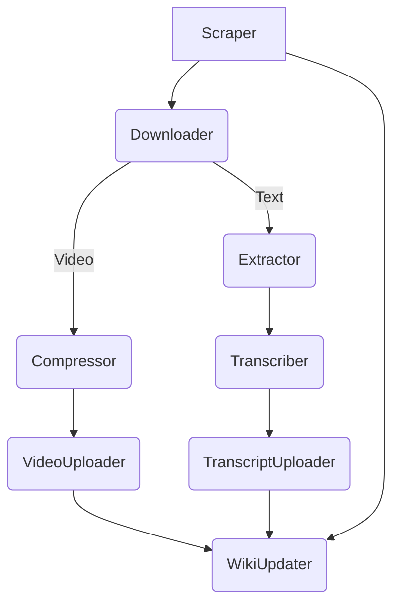

# Transparent Clayton
## Daily CC Video processing pipeline


## Unit Tests
`pipenv run python -m unittest discover`

## Resetting a meeting's AI summary
If a summary was generated from bad input and should be redone, remove it with
`scripts/reset_summary.py`. It deletes the meeting's summary files, its rows in the
RAG index and its `summarized.<type>` Redis entry, so the next
`backfill_history.py --stage summaries` regenerates it. It is a read-only audit
unless you pass `--execute`, and it leaves legacy summaries (no `.sections.json`)
alone. Stop any run that is writing the same meeting first.

```
python scripts/reset_summary.py --type bac_mtg "2024-07-10 04_00 PM"             # audit
python scripts/reset_summary.py --type bac_mtg "2024-07-10 04_00 PM" --execute   # apply
```

To regenerate just that meeting afterwards, scope the summaries stage to it with
`--key` (needs `--type`; supported for `--stage summaries` and `--stage wiki`):

```
python scripts/backfill_history.py --stage summaries --type bac_mtg --key "2024-07-10 04_00 PM" --execute
```

`--type` is the meeting type key (`cc_mtg`, `pc_mtg`, `bac_mtg`, `csse_mtg`, `fsc_mtg`,
`tlc_mtg`, `ghad_mtg`, `gen_mtg`); several meeting keys can be given at once.
